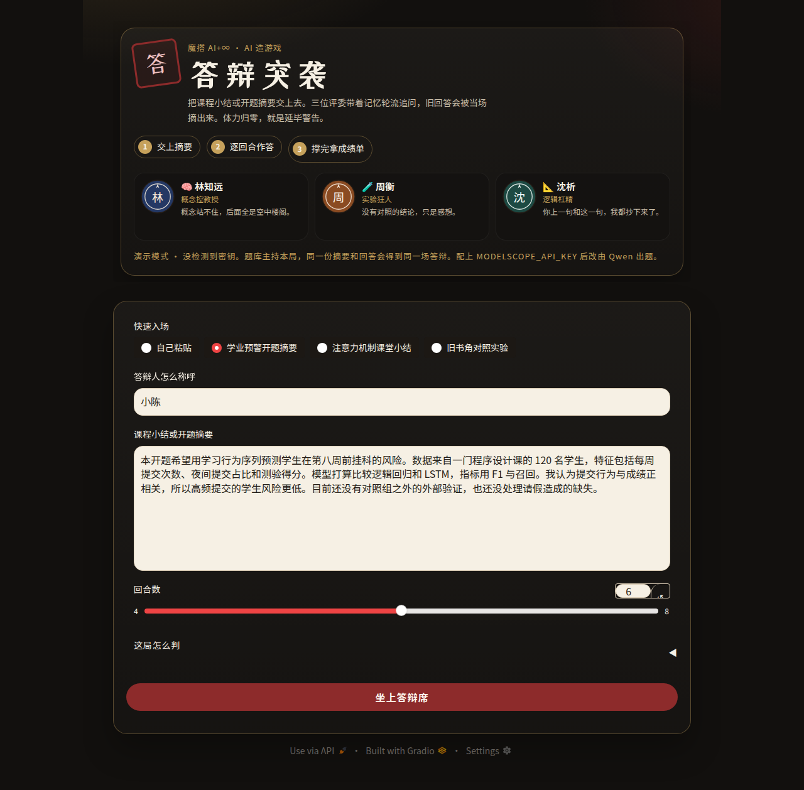
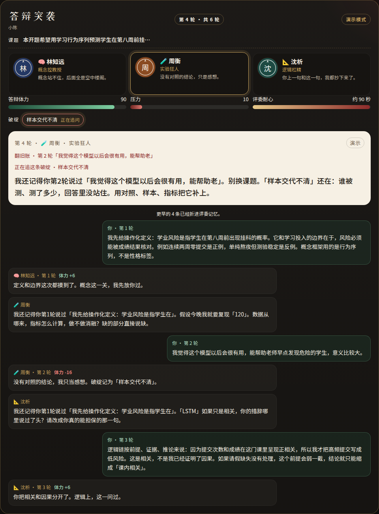
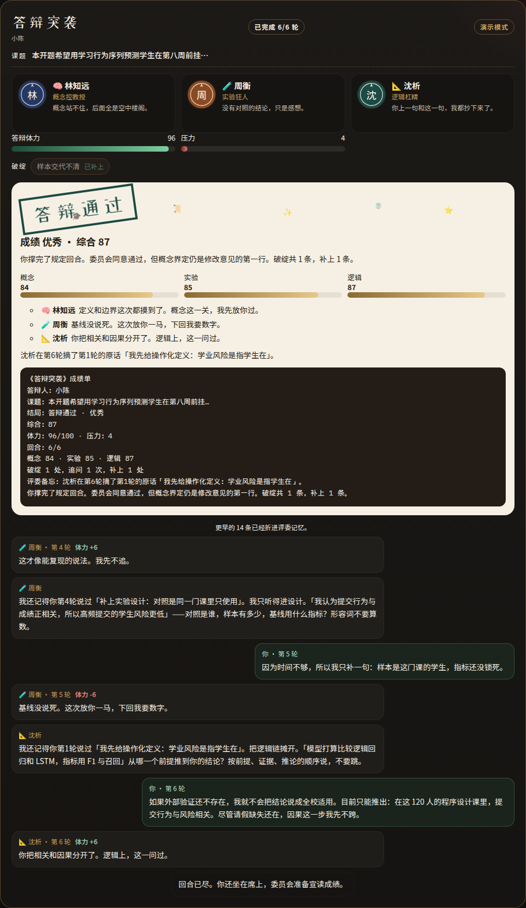

# 答辩突袭

把课程小结或开题摘要交上去，三位带着记忆的评委轮流追问。撑完规定回合算答辩通过；体力归零，盖章「延毕警告」。

这是提交给魔搭 ModelScope AI+∞「AI 造游戏」的一款回合制答辩游戏。页面是 Gradio，可以直接部署到创空间。没有 API Key 时走确定性演示模式，评委点开也能打完一局。

下面的图都来自演示模式。



## 怎么玩

1. 粘贴摘要，或点一个示例课题。
2. 选 4 到 8 个回合，默认 6 回合。点「坐上答辩席」。
3. 林知远（概念控）、周衡（实验狂人）、沈析（逻辑杠精）前三轮各问一次。
4. 从第四轮起，没补上的破绽会被原来的评委追问。同一人最多连问两轮。
5. 评委会摘引你前面的原话。答得虚会掉体力并留下破绽，答得扎实最多回 6 点。
6. 体力归零是延毕警告。撑完回合会给出概念 / 实验 / 逻辑成绩单，下面有一段可以复制转发的文字。





## 本地运行

需要 Python 3.10 及以上。

```bash
pip install -r requirements.txt
python app.py
```

浏览器打开 http://127.0.0.1:7860 。

不配密钥就是演示模式。强制演示：

```bash
DABIAN_MOCK=1 python app.py
```

命令行打一局示例，不打开浏览器：

```bash
python -m game
```

开发依赖和测试：

```bash
pip install -r requirements-dev.txt
pytest
```

## 环境变量

| 变量 | 作用 |
|---|---|
| `MODELSCOPE_API_KEY` | 魔搭推理令牌。配上之后走在线评委。 |
| `DASHSCOPE_API_KEY` | 只有百炼令牌时用这个。会改走 DashScope 兼容地址，模型名改为 `qwen2.5-72b-instruct`。 |
| `MODELSCOPE_BASE_URL` | 覆盖端点。默认 `https://api-inference.modelscope.cn/v1/`。 |
| `MODELSCOPE_MODEL` | 覆盖模型。默认 `Qwen/Qwen2.5-72B-Instruct`。 |
| `DABIAN_MOCK` | 设为 `1` / `true` / `yes` / `on` 时，即使有密钥也用演示题库。 |
| `PORT` 或 `GRADIO_SERVER_PORT` | 监听端口，默认 `7860`。 |

密钥只放环境变量，不要写进代码或 README。摘要留在当次会话里，没有账号，也没有排行榜。

在线请求失败会再试一次。还是失败的话，这一回合改用演示题库，页面上会写明，对局不中断。演示模式不访问网络，同一段摘要配上同一串回答，题目和扣血逐字相同。

## 部署到魔搭创空间

1. 登录 [魔搭](https://www.modelscope.cn)，进入创空间，创建空间。
2. SDK 选 **Gradio**。名称可以用「答辩突袭」。可见性设为公开。
3. 硬件用 CPU 基础版就够。出题走推理 API，空间本身不需要 GPU。
4. 上传本仓库。入口是根目录的 `app.py`，依赖看 `requirements.txt`。至少要带上 `game/` 目录和 `LICENSE`。
5. 在空间设置里添加环境变量 `MODELSCOPE_API_KEY`。用百炼的话改填 `DASHSCOPE_API_KEY`，并按上一节设置端点和模型名。
6. 等构建完成，自己先打一局。不填密钥也能完整体验，方便评审直接点开。
7. 到活动页提交：创空间链接、创作手记、演示视频。手记初稿在 `创作手记.md`，两分钟分镜在 `DEMO_SCRIPT.md`。

## 目录

```
app.py              Gradio 入口
game/engine.py      回合、体力、破绽、旧账
game/mock_brain.py  无密钥时的确定性评委
game/llm.py         OpenAI 兼容客户端与失败回退
game/scoring.py     伤害钳制和成绩单
game/render.py      答辩席 HTML
game/theme.css      界面
tests/              pytest
创作手记.md
DEMO_SCRIPT.md
```

## 报名还要你本人做的事

代码和文案可以先准备好。下面几步必须用你自己的魔搭账号和社交账号：

- 发一条参赛构想帖，带上本期活动要求的话题，并 @魔搭ModelScope社区 @Qoder。发之前打开活动页核对话题，不要只靠这份草稿。
- 把帖子链接交到活动页，这一步才算报名。报名截止 2026-12-01 12:00，作品截止当天 18:00（北京时间）。
- 用你的账号把空间设为公开，并提交空间链接、手记和演示视频。

构想帖草稿：

**标题：** 我来做一款「AI 评委当场喷你」的答辩游戏

**正文：**

期末最怕什么？不是复习，是老师突然问一句「你刚才说的和摘要矛盾了吧」。

所以我想做一款能直接点开玩的小游戏——《答辩突袭》：你丢一段课程小结或开题摘要进去，三位 AI 评委带着记忆上场，专抠概念、实验和逻辑漏洞，还会翻你前几轮的回答继续追问。撑完就过关，答崩就「延毕警告」。

核心玩法是回合制答辩。部署用魔搭创空间和 Gradio，模型走通义千问 Qwen。角色记忆和破绽状态会改后面的问题，没有这层就不算一局。

从「我想玩」到「我来做」，先把 flag 立在这儿。

#AI无限开发者创作大赛 #AI造游戏 #Qoder #魔搭社区 #AIGC
@魔搭ModelScope社区 @Qoder

## 许可

MIT，见 `LICENSE`。
